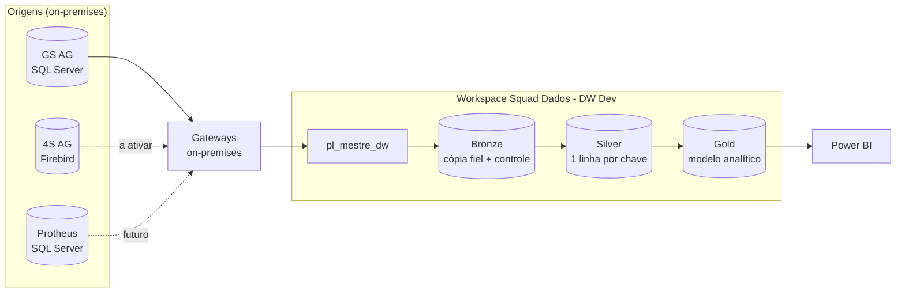
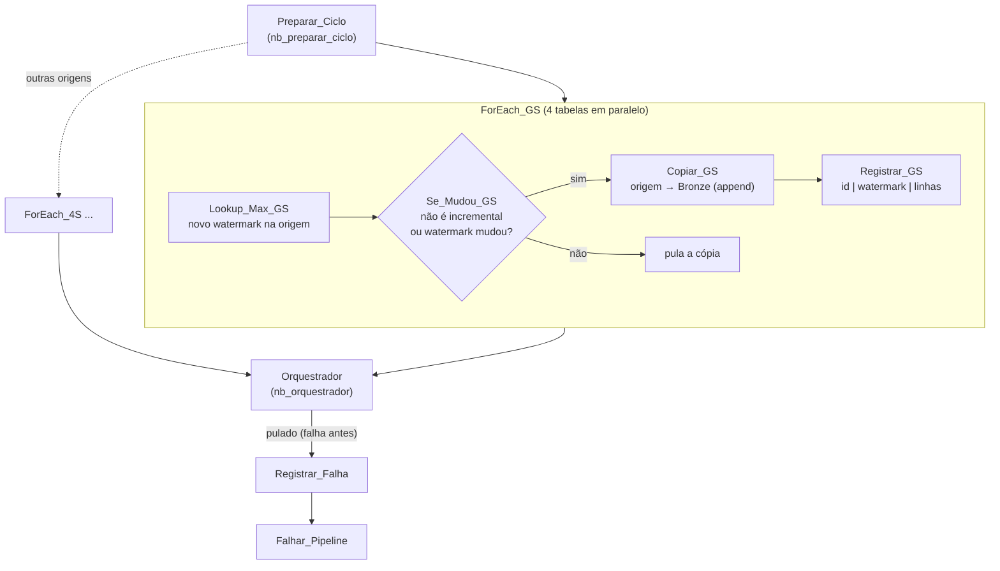

# DW no Microsoft Fabric: documentação do projeto

Visão geral do ambiente: o que foi construído, como os dados fluem, o que faz cada notebook e o pipeline, e como operar.

**Situação em 22/10/2026:** a origem **GS AG** (Fortes, SQL Server) está implantada no DW Dev, com as 29 tabelas carregadas na Bronze e na Silver e os ciclos completo e de fatos validados. A origem **4S AG** (Fortes, Firebird) também está carregada: 29 tabelas, ciclo completo validado. O pipeline já carrega as duas origens.

Outros documentos:
- [00 – Guia padrão: incluir um sistema novo](00_guia_nova_origem.md) (comece por aqui)
- [01 – Detalhes técnicos da Bronze para uma nova origem](01_nova_origem_bronze.md)
- [02 – Levantamento para padronização da Silver](02_levantamento_silver.md)
- [04 – Dicionário canônico e de-para de campos](04_dicionario_canonico.md)

---

## 1. Arquitetura



| Camada | Lakehouse | Conteúdo | Regra |
|---|---|---|---|
| **Bronze** | `Bronze` | Cópia das tabelas da origem, cada ciclo **acrescentado** (append), sem credenciais, mais as tabelas de controle `ctl_*` | Tipos da origem, sem tratamento. Retenção: 3 dias para FULL e JANELA, 30 dias para INCREMENTAL |
| **Silver** | `Silver` | Uma linha por chave de negócio, sempre com a versão mais recente, com tipos padronizados | MERGE para tabelas incrementais e substituição completa para tabelas FULL. Regras de tipo em [02](02_levantamento_silver.md#3-regras-propostas-para-a-silver) |
| **Gold** | `Gold` | Fatos e dimensões de negócio para o Power BI | Ainda não iniciada (Fase 4) |

Tecnologia: os notebooks são **PySpark** (Fabric Runtime 2.0: Spark 4.1, Delta 4.2, Python 3.13), para o DW crescer sem trocar de motor: mais volume pede só mais nós no pool ou capacidade maior, sem mudar código. As consultas das Golds (`implantacao/consultas/*.sql`) são Spark SQL. A cópia das origens é feita pela **Copy activity** do pipeline, através do gateway.

Pontos do Spark neste ambiente (desde 27/10/2026; antes os notebooks eram Python com `deltalake` e `duckdb`):
- **Caminhos do OneLake por ID:** o nome do workspace ("Squad Dados - DW Dev") tem espaços, que o ABFS do Spark não aceita. O `comum.py` monta os caminhos com o ID do workspace e do lakehouse (`raiz()`).
- **Capacidade F4:** o pool inicial começa cada sessão com 1 nó Medium (8 vCores) e só cresce se houver folga, então cabem até 3 sessões ao mesmo tempo. A sessão Spark leva mais para subir que o notebook Python: a rotina de 5 min passou de 1,5 a 2 min para 3 a 4 min por execução.
- **Horário:** sessão e processo em UTC (`comum.py`), porque as datas da Bronze são horário de Brasília rotulado UTC.

---

## 2. Ambiente

| Item | Nome | ID |
|---|---|---|
| Capacidade | `grupokmf` (F4) | `4edcfa75-772f-4f7f-9eff-b42b976e02ff` |
| Workspace DEV | Squad Dados - DW Dev | `db0cf901-d6a7-4cf4-aaeb-f24d0e09a9e9` |
| Workspace PROD | DW_PROD | *ainda não criado* |
| Lakehouse | Bronze | `9e23d513-0ddd-4671-8940-2728cb1bb64e` |
| Lakehouse | Silver | `203e4280-9163-4a33-b7b7-b80edeeb409d` |
| Lakehouse | Gold | `1ee545d4-58f7-4253-b931-4757d1e266b9` |
| Notebook | nb_setup_controle | `35570451-9727-4c91-bb10-c9d02b7591d2` |
| Notebook | nb_preparar_ciclo | `87b8adbb-b0f5-40e5-bb58-3ba5422885bf` |
| Notebook | nb_orquestrador | `a357c6d2-979a-45db-b6af-aac06fcd9c4e` |
| Notebook | nb_ingestao_api | `f8959b17-ca80-4ad2-898c-881125d8d754` |
| Key Vault | `kv-dw-fabric-kmf` (grupo `grupokmf`, East US) | `https://kv-dw-fabric-kmf.vault.azure.net/` |
| Pipeline | pl_mestre_dw | `4ae3857c-2708-4e6c-804a-f5f467a7f52b` |

### Origens e conexões

| Origem | Sistema / banco | Conexão no Fabric | ID da conexão | Situação |
|---|---|---|---|---|
| `GS` | Fortes GS AG · SQL Server `10.1.0.38` / `GSAG` | Fortes AG GS - Cloud | `45393625-ea40-4705-9a62-14e2e875d8f7` | **Ativa** |
| `4S` | Fortes 4S AG · Firebird `AG_4S.FDB` | FORTES AG 4S - FIREBIRD | `2783e8cb-469a-4581-80f7-b4e5f0fc448a` | **Ativa** |
| `NEXTI` | Nexti (ponto e escalas) · API REST `api.nexti.com` | — (credenciais no Key Vault `kv-dw-fabric-kmf`) | — | **Ativa**, recuperando o histórico desde 01/01/2025 ([decisões](origens/nexti/proposta.md)) |
| `PROTHEUS` | Protheus (TOTVS) · SQL Server `45.6.153.9,1819` / `C7FTHA_136941_PR_PD` | Protheus PROD | `c4b4f96f-b6a6-40f4-8dbb-2351c2e6dd83` | **Ativa** desde 27/10/2026: 14 tabelas da empresa 01 (financeiro, notas fiscais e cadastros) |
| `VIGON` | Fortes VIGON AG · Firebird `AG_VIGON.FDB` | FORTES AG VIGON - NOVO IP | `72c5e5df-7d5a-4644-ac6e-6bae020b9e2d` | **Ativa** desde 27/10/2026: as mesmas 29 tabelas do GS e do 4S |

---

## 3. Padrão de nomes

| O quê | Padrão | Exemplo |
|---|---|---|
| Lakehouses | Nome da camada. **Não renomear:** o banco do SQL endpoint mantém o nome da criação e a sincronização das tabelas passa a falhar | `Bronze`, `Silver`, `Gold` |
| Tabela na Bronze | `bronze_{fato\|dim}_{assunto}_{origem}` | `bronze_fato_contas_receber_gs` |
| Tabela na Silver | `silver_{fato\|dim}_{assunto}_{origem}` | `silver_dim_clientes_4s` |
| Tabelas de controle | `ctl_{nome}` (na Bronze) | `ctl_tabelas` |
| Colunas técnicas | prefixo `_` | `_lote`, `_dt_carga` |
| `id` da tabela no controle | `{ORIGEM}.{tabela_origem}` em maiúsculas | `GS.DBO.CRE`, `4S.CRE` |

O controle guarda só o nome base (`fato_contas_receber_gs`). Os prefixos `bronze_` e `silver_` são colocados pelas funções `nome_bronze()` e `nome_silver()` em [`comum.py`](../implantacao/src/comum.py).

### Colunas técnicas

| Coluna | Camada | Significado |
|---|---|---|
| `_origem` | Bronze e Silver | Sistema de origem (`GS`, `4S`) |
| `_lote` | Bronze e Silver | ID da execução do pipeline que trouxe a linha |
| `_dt_carga` | Bronze e Silver | Data e hora da leitura na origem |
| `_ativo` | Silver | `true` = existe na origem. Base para a futura detecção de exclusões |
| `_dt_atualizacao` | Silver | Data e hora da gravação na Silver |

---

## 4. Tabelas de controle (lakehouse Bronze)

O DW é **orientado a metadados**: o pipeline não tem tabela fixa. A cada ciclo, ele lê o que carregar destas tabelas.

### `ctl_origens`: uma linha por sistema

| Coluna | Uso |
|---|---|
| `origem` | `GS`, `4S`, `PROTHEUS`, `VIGON` |
| `dialeto` | `SQLSERVER` ou `FIREBIRD`. Define a sintaxe das consultas |
| `ativo` | `false` = a origem fica fora dos ciclos |

### `ctl_tabelas`: uma linha por tabela (58 hoje: 29 GS + 29 4S)

| Coluna | Uso |
|---|---|
| `id` | Identificador único (`GS.DBO.LAN`) |
| `origem`, `tabela_origem`, `tabela_destino` | De onde lê e o nome base no DW |
| `tipo` | `DIM` (só no ciclo completo) ou `FATO` (em todos os ciclos) |
| `modo_carga` | `FULL`, `INCREMENTAL` ou `JANELA` |
| `colunas` | Colunas lidas (`*` = todas) |
| `coluna_watermark`, `tipo_watermark` | Coluna de controle incremental (`DATA` ou `ID`) |
| `ultimo_watermark` | Até onde já foi carregado. **Só o orquestrador altera**, e só em ciclo bem-sucedido |
| `chave_negocio` | Chave do MERGE na Silver |
| `janela_seguranca_min` | Minutos de sobreposição no incremental (10), para pegar transações que estavam em andamento |
| `janela_dias` | Dias recarregados no modo `JANELA` |
| `filtro_adicional` | Filtro SQL fixo (ex.: `D_E_L_E_T_ = ' '`) |
| `ativo` | `false` = tabela fora dos ciclos |

### `ctl_log`: histórico de cada ciclo

Uma linha por tabela e etapa (`BRONZE`, `SILVER`, `GOLD`) e uma linha de resumo (`CICLO`) com status, linhas e mensagem de erro.

### Cadastro atual do GS AG

| Carga | Tabelas |
|---|---|
| **Incremental** por `DataUltimaAlteracao` (6 fatos) | LAN, CPG, CRE, BVP, BVD, TCF |
| **FULL** (11 fatos sem coluna de alteração) | NFS, ORL, VDR, VCP, SCR, RDL, DCP, RRR, LAF, VSE, VRD |
| **FULL** (12 dimensões) | CLI, FRN, CRS, CRD, EST, CON, SER, BAN, GFR, APF, GCL, EMP |

---

## 5. Notebooks

O código-fonte fica em [`implantacao/src/`](../implantacao/src/), em arquivos `.py` com células `# %%`. O script `build_notebooks.py` gera os `.ipynb` em `implantacao/notebooks/`, que são os arquivos enviados ao Fabric. O bloco comum (`comum.py`) entra em todos os notebooks no lugar do marcador `#@@COMUM@@`.

### `comum.py`: configuração compartilhada
- Nomes dos lakehouses (`LH_BRONZE`, `LH_SILVER`, `LH_GOLD`) e o fuso de Brasília.
- Funções de leitura e gravação Delta no OneLake: `ler`, `gravar`, `existe`, `tabela_delta`.
- `nome_bronze()` e `nome_silver()`, que montam o nome físico das tabelas.
- Modo local (`DW_LOCAL_ROOT`), para rodar os notebooks no computador, sem Fabric, nos testes.

### `nb_setup_controle`: cadastro
- **Quando roda:** depois de alterar o cadastro (`implantar_fundacao.py --executar-setup`) e uma vez em cada workspace novo.
- **Cadastro fora do código**, na pasta [`config/`](../config/), copiada pela implantação para o lakehouse Gold → `Files/config`:
  - [`tabelas.yml`](../config/tabelas.yml): origens e, por base, as tabelas (tabela, tipo, assunto, chave, coluna de alteração, margem). A base `FORTES` vale para GS e 4S;
  - [`colunas_permitidas.yml`](../config/colunas_permitidas.yml): lista explícita das tabelas com credenciais (CLI, EMP, EST e NFS) e as colunas ausentes no 4S;
  - [`nexti.yml`](../config/nexti.yml): endpoints e campos da API Nexti.
- **O que faz:**
  1. Regrava `ctl_origens` a partir de `tabelas.yml`.
  2. Monta as tabelas de cada base para cada origem dela. Nas tabelas de `colunas_permitidas.yml`, usa a lista explícita em vez de `*`.
  3. **Valida** cada linha: campos obrigatórios, campos desconhecidos (erro de digitação), tipos válidos, endpoint existente em `nexti.yml`, nome em minúsculas e duplicidade.
  4. Faz upsert em `ctl_tabelas` **sem apagar o `ultimo_watermark`**.
  5. Cria `ctl_log`, se ainda não existir.
- Pode ser executado quantas vezes quiser.

### `nb_preparar_ciclo`: planejamento do ciclo
- **Quando roda:** primeira atividade do pipeline.
- **Parâmetros:** `ciclo` (`AUTO`, `COMPLETO` ou `FATOS`) e `lote`.
- **O que faz:**
  1. Resolve `AUTO`: antes das 09:00 (Brasília) é `COMPLETO` (dimensões e fatos); depois, `FATOS`.
  2. Lê as tabelas ativas das origens ativas.
  3. Monta, para cada tabela, duas consultas no dialeto da origem:
     - `query_max`: lê o novo watermark na origem, como `MAX(DataUltimaAlteracao)`;
     - `query_copy`: a consulta de cópia, com a janela `> último watermark − 10 min` e `<= novo watermark`, mais as colunas técnicas.
  4. Devolve ao pipeline um JSON com a lista de tabelas por origem.

### `nb_ingestao_api`: origens API (Nexti)
- **Quando roda:** no pipeline, em paralelo às cópias dos bancos (atividade `Ingestao_API`).
- **Parâmetros:** `lote`, `ciclo` (já resolvido pelo preparador), `origens` (filtro), `configuracao_api` (URL do Key Vault de cada origem), `inicio_historico` (01/01/2025) e `max_dias_por_execucao` (45).
- **O que faz:**
  1. Lê as credenciais no Key Vault e obtém o token da API.
  2. Para cada tabela ativa da origem, chama o endpoint definido em `config/nexti.yml`: os cadastros por inteiro e as fatos pela janela que vai do último watermark (menos a margem) até agora, em blocos do tamanho que a API aceita.
  3. Grava **só os campos listados em `config/nexti.yml`**, com tipos fixos. Converte as datas `ddMMyyyyHHmmss`, passa os horários UTC das marcações para Brasília e troca datas fictícias por nulo.
  4. Faz append na Bronze, bloco a bloco, com as colunas técnicas.
  5. Devolve ao orquestrador a lista `id|novo_watermark|linhas`, no mesmo formato do pipeline.
- Na recuperação do histórico, cada ciclo avança no máximo 45 dias por tabela. O watermark só avança com o ciclo inteiro bem-sucedido.

### `nb_orquestrador`: Silver, Gold e fechamento
- **Quando roda:** última atividade do pipeline, depois de todas as cópias.
- **Parâmetros:** `lote`, `ciclo`, `resultados` (lista `id|novo_watermark|linhas` montada pelo pipeline), `status_ciclo` e `mensagem`.
- **O que faz:**
  1. Para cada tabela copiada, lê na Bronze só as linhas do lote atual.
  2. Confere se as colunas da chave existem.
  3. Remove duplicidades do lote: fica a versão mais recente de cada chave.
  4. **Padroniza** (`padronizar()`): float vira `DECIMAL(18,6)`, os textos perdem os espaços do fim, texto vazio vira nulo e as colunas binárias saem.
  5. Grava na Silver: **substitui** a tabela inteira (FULL) ou faz **MERGE** pela chave (INCREMENTAL).
  6. Roda os notebooks Gold ligados às tabelas alteradas (`GOLD_NOTEBOOKS`, vazio por enquanto).
  7. **Só se tudo deu certo**, avança o `ultimo_watermark`.
  8. **Só no ciclo COMPLETO**, aplica a retenção da Bronze (`aplicar_retencao()`, prazos em `RETENCAO_DIAS`):
     - apaga os lotes mais antigos que o prazo;
     - compacta os arquivos pequenos;
     - roda `VACUUM`, que remove fisicamente o que tem mais de 7 dias.
     Uma falha aqui é registrada no log (etapa `RETENCAO`), mas não derruba o ciclo.
  9. Grava o `ctl_log`.
- Com `status_ciclo = FALHA`, só registra a falha no log. Nada é alterado.

---

## 6. Pipeline `pl_mestre_dw`

Gerado por [`pipeline_mestre.py`](../implantacao/pipeline_mestre.py). Há um `ForEach` por origem, porque a conexão do gateway não pode ser parametrizada por expressão.



| Atividade | Tipo | Função |
|---|---|---|
| `Preparar_Ciclo` | Notebook | Planeja o ciclo e monta as consultas |
| `ForEach_{origem}` | ForEach (paralelismo 4) | Percorre as tabelas da origem |
| `Lookup_Max_{origem}` | Lookup | Lê o novo watermark **antes** da cópia |
| `Se_Mudou_{origem}` | If | Pula a cópia de tabela incremental sem alteração |
| `Copiar_{origem}` | Copy | Copia da origem para `bronze_*` pelo gateway (append) |
| `Registrar_{origem}` | Append Variable | Acumula `id|watermark|linhas` para o orquestrador |
| `Ingestao_API` | Notebook (`nb_ingestao_api`) | Lê as origens API e grava na Bronze, em paralelo aos `ForEach` |
| `Orquestrador` | Notebook | Grava a Silver, avança os watermarks e grava o log |
| `Registrar_Falha` | Notebook | Registra no log uma falha anterior ao orquestrador |
| `Falhar_Pipeline` | Fail | Marca a execução como falha |

**Parâmetros:** `ciclo` (padrão `AUTO`) e `origens` (vazio = todas as ativas; ex.: `NEXTI` roda só a Nexti).

### Rodar todas as origens ou só algumas

O mesmo pipeline atende os dois casos. O parâmetro `origens` escolhe o que entra no ciclo:

| `origens` | O que roda |
|---|---|
| vazio | Todas as origens ativas (GS, 4S e Nexti hoje). É o que o agendamento usa |
| `GS` | Só o GS |
| `GS,4S` | GS e 4S, sem a Nexti |
| `NEXTI` | Só a Nexti |

Pelo terminal, sem reimplantar:

```powershell
.\.venv\Scripts\python.exe implantacao\executar_ciclo.py                         # todas, ciclo AUTO
.\.venv\Scripts\python.exe implantacao\executar_ciclo.py --origens GS            # só o GS
.\.venv\Scripts\python.exe implantacao\executar_ciclo.py --origens 4S,NEXTI --ciclo COMPLETO
```

**Pelo Fabric, com um clique:** cada atalho chama o `pl_mestre_dw` com a origem já preenchida. Abra o atalho e clique em **Executar**. O `ciclo` vem como `AUTO` e pode ser trocado na tela de execução.

| Pipeline | Atualiza |
|---|---|
| `pl_atualizar_todas` | Todas as origens ativas |
| `pl_atualizar_gs` | Só o GS |
| `pl_atualizar_4s` | Só o 4S |
| `pl_atualizar_nexti` | Só a Nexti |

Os atalhos são gerados pela implantação a partir da lista `atalhos` do `config_fundacao.json`. Origem nova = acrescentar a sigla na lista e reimplantar. Também dá para executar o próprio `pl_mestre_dw` e preencher `origens` à mão.

Regras:
- Nome errado ou origem inativa (ex.: `G5`, ou uma origem com `ativo: false`) **falha no Preparar_Ciclo**, com a lista das origens válidas. Um ciclo vazio não termina como sucesso.
- Execuções de **origens diferentes** podem rodar ao mesmo tempo: cada uma só mexe nas tabelas das suas origens, inclusive na retenção da Bronze, e a gravação dos watermarks e do log tenta de novo se as duas terminarem juntas.
- **Não rode a mesma origem** em duas execuções simultâneas: as duas copiariam a mesma janela.
- O `ctl_log` registra no resumo do ciclo quais origens rodaram.

**Falhas:** se qualquer tabela falhar, o watermark não avança. O ciclo seguinte reprocessa a mesma janela e o MERGE evita duplicar linhas.

### Ciclos

| Ciclo | Quando | O que carrega |
|---|---|---|
| `COMPLETO` | 05:00, ou `AUTO` antes das 09:00 | Dimensões + fatos |
| `FATOS` | 12:00 e 17:00, ou `AUTO` depois das 09:00 | Só fatos |

Agendamento previsto **só no DW_PROD**: 05:00, 12:00 e 17:00 com `ciclo = AUTO`. O DW Dev não tem agendamento.

### Resultados dos testes (GS AG, 22/10/2026)

| Ciclo | Tabelas | Linhas copiadas | Resultado |
|---|---|---:|---|
| 1º `COMPLETO` | 29 | 5.395.532 | Sucesso. Bronze = Silver em todas as tabelas, sem duplicidade de chave |
| 1º `FATOS` | 16 (5 incrementais com alteração + 11 FULL; TCF pulada) | 2.802.134 | Sucesso. LAN copiou 18 linhas, e não 868 mil |

---

## 7. Implantação

Tudo é criado pela API REST do Fabric com [`implantar_fundacao.py`](../implantacao/implantar_fundacao.py), lendo [`config_fundacao.json`](../implantacao/config_fundacao.json). Pode ser executado várias vezes: o que existe é atualizado, sem duplicar.

| Opção | Efeito |
|---|---|
| *(sem opção)* | Implanta tudo: workspaces, lakehouses, notebooks e pipeline |
| `--listar-conexoes` | Lista gateways e conexões com os IDs |
| `--somente-itens` | Não cria os workspaces fora de `implantar_itens_em` (ex.: não cria o DW_PROD) |
| `--origens GS` | Gera o pipeline só com estas origens (`GS,4S` para várias) |
| `--executar-setup` | Roda o `nb_setup_controle` depois de implantar |
| `--executar-ciclo COMPLETO` | Roda o `pl_mestre_dw` com o ciclo informado e espera o fim |
| `--ciclo-origens NEXTI` | Junto com `--executar-ciclo`: roda o ciclo só dessas origens |

Exemplos:

```powershell
# atualizar o DW Dev depois de mudar código (sem rodar nada)
.\.venv\Scripts\python.exe implantacao\implantar_fundacao.py --somente-itens --origens GS

# rodar um ciclo de fatos de teste
.\.venv\Scripts\python.exe implantacao\implantar_fundacao.py --somente-itens --origens GS --executar-ciclo FATOS
```

Requisitos: Python 3.10+ e `pip install azure-identity requests truststore`. O `truststore` faz o Python usar os certificados do Windows, necessário na rede da empresa, que inspeciona TLS. O login abre no navegador com a conta Microsoft.

Os IDs criados são gravados em `implantacao/manifesto_implantacao.json`.

---

## 8. Estrutura do repositório

```
project_DW_Fabric/
├── docs/                          documentação (este arquivo)
│   ├── inventario_colunas_silver.csv
│   ├── modelos/                   planilha modelo para uma origem nova
│   └── origens/<sistema>/         insumos e proposta de cada origem nova
├── implantacao/mapeamento/        dicionário canônico e de-para de campos
├── fabric/DW_DEV/                 pasta para a integração Git do workspace
└── implantacao/
    ├── config_fundacao.json       capacidade, workspaces e conexões
    ├── implantar_fundacao.py      implantação pela API do Fabric
    ├── pipeline_mestre.py         gerador do pl_mestre_dw
    ├── build_notebooks.py         src/*.py → notebooks/*.ipynb
    ├── (testes em tests/, com pytest) teste do ciclo sem Fabric
    ├── LEIA-ME.md                 passo a passo da Fase 1
    ├── src/                       código-fonte dos notebooks (editar aqui)
    └── notebooks/                 notebooks gerados (não editar à mão)
```

**Regra:** altere sempre os arquivos em `src/`, gere os notebooks com `build_notebooks.py` e implante. Uma alteração feita direto no notebook do Fabric é perdida na próxima implantação.

---

## 9. Operação

**Conferir o último ciclo** (SQL endpoint do lakehouse Bronze):

```sql
SELECT tabela_id, etapa, linhas, status, mensagem
FROM ctl_log
WHERE lote = (SELECT TOP 1 lote FROM ctl_log ORDER BY dt_registro DESC)
ORDER BY etapa, tabela_id;
```

**Ver até onde cada tabela incremental foi carregada:**

```sql
SELECT id, ultimo_watermark, dt_atualizacao FROM ctl_tabelas
WHERE modo_carga = 'INCREMENTAL' ORDER BY id;
```

**Forçar a recarga completa de uma tabela incremental:** zere o `ultimo_watermark` dela (num notebook: `tabela_delta(LH_BRONZE, "ctl_tabelas").update("id = '<ID>'", {"ultimo_watermark": "NULL"})`) e rode um ciclo.

**Desligar uma tabela:** `ativo=False` na lista do `nb_setup_controle` e rode o setup.

---

## 9.1 Testes, qualidade e monitoramento

**Isolamento entre bases.** Uma base ou tabela com falha não trava as outras:
- no `pl_mestre_dw`, o orquestrador roda mesmo se o `ForEach` de uma origem ou a `Ingestao_API` falhar (dependência *Completed*);
- o orquestrador leva para a Silver e avança o watermark só das tabelas que deram certo; as que falharam ficam com o watermark parado e aparecem no `ctl_log` (o ciclo fica `PARCIAL`), e o pipeline termina vermelho para alertar;
- o `nb_ingestao_api` devolve `FALHA` por tabela em vez de parar no primeiro erro; no `nb_rotina_nexti`, uma rotina com falha não impede as outras.

**Testes unitários** (`tests/`, pytest): rodam os notebooks localmente, com PySpark e Delta, sem Fabric, sobre lakehouses temporários, e cobrem preparo do ciclo, padronização da Silver, isolamento, regras das Golds e o motor de qualidade.

O Spark local precisa de Java 21; no Windows, os testes rodam num contêiner com as versões do Fabric (`tests/docker/Dockerfile`, Docker Desktop ligado):

```powershell
docker build -t dw-fabric-testes tests/docker                  # uma vez (e quando mudar o Dockerfile)
docker run --rm -v "${PWD}:/projeto" dw-fabric-testes          # na raiz do projeto
```

Na rede da empresa, que inspeciona o TLS, os certificados raiz do Windows precisam estar em `tests/docker/certificados/` (arquivo `.crt` em PEM, fora do Git) antes do build.

O GitHub roda os mesmos testes a cada push e pull request (`.github/workflows/ci.yml`), com Java 21 e PySpark.

**Qualidade dos dados** (`nb_qualidade` + `config/qualidade.yml`). As regras ficam no YAML (chave única, não nulo, linhas proibidas, valores permitidos, faixa de datas, mínimo de linhas, sem timestamp sem fuso), com grupo (`AUSENCIAS`, `COBERTURAS`, `MARCACAO`, `GERAL`) e severidade (`erro` ou `alerta`). O resultado de cada regra vai para `ctl_qualidade`. Roda uma vez por dia em cada rotina e pode ser executado à mão com `grupo` vazio (todas).

**Monitoramento** (`nb_monitoramento`, a cada 30 min pelas rotinas e no fim do `pl_mestre_dw`). Grava em `ctl_alertas`:

| Alerta | Quando |
|---|---|
| `ROTINA_ATRASADA` | rotina sem executar além do limite, dentro da janela |
| `TABELA_PARADA` | tabela incremental com watermark parado além de `tabelas_incrementais_max_horas` |
| `FALHA_*` | etapa com FALHA ou PARCIAL no `ctl_log` |
| `VOLUME_BAIXO` | tabela FULL do ciclo completo com queda grande em relação à média |
| `QUALIDADE` | regra do `qualidade.yml` quebrada |

O mesmo alerta não se repete por `silenciar_horas`. Os alertas novos das severidades em `monitoramento.notificacao` (hoje `erro`) também vão para o Teams, num cartão, por um **Workflow do Teams** ("Enviar alertas de webhook para um chat"). A URL do Workflow fica no Key Vault (segredo `teams-webhook-dw`). Enquanto não há canal oficial, o Workflow entrega no chat de `victoria.araujo@gscsc.com.br`. Para trocar pelo canal: criar o Workflow do canal, gravar a nova URL no mesmo segredo e atualizar `destinatario` no `qualidade.yml`.

**Aviso de cada execução no Teams.** Além dos alertas acima, o `nb_orquestrador` (ciclos do pipeline) e o `nb_rotina_nexti` (rotinas) mandam para o mesmo Workflow um cartão com o resultado de cada execução: `BASE`, `Notebook/Pipeline`, `Status` (✅ SUCESSO / ⚠️ PARCIAL / ❌ FALHA), `Erro` (quando há), `Horário` e `Comportamento` — 🟢 NORMAL, 🟡 ATENÇÃO (concluiu acima de `duracao_atencao_s`) ou 🔴 ALERTA (falha). Config em `qualidade.yml`, `monitoramento.notificacao`: `avisar_execucoes` liga/desliga; `nexti_cada` evita o excesso das rotinas (5 em 5 min), avisando o sucesso NORMAL só 1 vez a cada N execuções (hoje 3) — falha, PARCIAL e ATENÇÃO avisam sempre. O contador fica em `ctl_contador` (Bronze). A rotina faz o próprio aviso e manda `notificar=NAO` ao `nb_orquestrador` que chama, para não duplicar.

```sql
-- últimos alertas (SQL endpoint do lakehouse Bronze)
SELECT dt_alerta, severidade, tipo, mensagem FROM ctl_alertas ORDER BY dt_alerta DESC;
-- última verificação de qualidade
SELECT * FROM ctl_qualidade WHERE dt_execucao = (SELECT MAX(dt_execucao) FROM ctl_qualidade);
```

## 10. Pendências e próximos passos

| # | Item | Prioridade |
|---|---|---|
| 1 | **Com a TI:** avaliar a troca das credenciais que foram copiadas antes da correção: certificado A1 e senha, tokens do Banco do Brasil, PJBank (ver [levantamento](02_levantamento_silver.md)) | **Alta** |
| 2 | Confirmar com a área os valores suspeitos do Fortes (ex.: `Juros` de 60 bilhões numa baixa a receber) | Média |
| 3 | Reduzir as fatos FULL grandes (NFS, ORL, SCR, VCP, VDR) para carga `JANELA` | Média |
| 4 | Confirmar com a área os 17 títulos a pagar do 4S com `NaN` em `IRRFCPF`/`IRRFCIOTCPF` (gravados como nulo na Silver) | Baixa |
| 5 | Rodar o primeiro ciclo conjunto GS + 4S (`FATOS`) para confirmar o pipeline com as duas origens | Média |
| 6 | Criar o DW_PROD, o deployment pipeline DEV → PROD e os agendamentos | Média |
| 7 | Integração Git do workspace com o GitHub (pasta `fabric/DW_DEV`) | Baixa |
| 8 | Camada Gold (Fase 4) e notebooks em `GOLD_NOTEBOOKS` | Próxima fase |
| 9 | Detecção de exclusões na origem (reconciliação semanal) | Depois do piloto |

---

## 11. Histórico

| Data | O que foi feito |
|---|---|
| 22/10/2026 | Workspace existente "Squad Dados - DW Dev" adotado como DW_DEV na capacidade `grupokmf` |
| 22/10/2026 | 29 tabelas do Fortes cadastradas para GS e 4S, com chaves primárias e coluna de alteração levantadas no GS AG |
| 22/10/2026 | Padrão de nomes `bronze_/silver_{fato\|dim}_{assunto}_{origem}` e lakehouses Bronze/Silver/Gold |
| 22/10/2026 | Implantação do GS AG; 1º ciclo completo (5,4 mi de linhas) e 1º ciclo de fatos validados |
| 22/10/2026 | Levantamento dos tipos da Silver e achado das colunas de credenciais |
| 22/10/2026 | 51 colunas de credenciais e binárias excluídas da carga; Bronze das 4 tabelas afetadas e toda a Silver recriadas |
| 22/10/2026 | Padronização de tipos na Silver (decimal, textos) e retenção automática da Bronze implantadas |
| 22/10/2026 | 4S AG (Firebird) ativado: 29 tabelas, 2,3 mi de linhas. Ajustes: colunas ausentes no 4S (`COLUNAS_AUSENTES`), nomes em maiúsculas e `NaN` → nulo. Pipeline com `ForEach_GS` e `ForEach_4S` |
| 22/10/2026 | Guia padrão para novas origens, dicionário canônico (21 entidades, 162 campos) e de-para do Fortes |
| 22/10/2026 | Nexti (API) incluída: Key Vault `kv-dw-fabric-kmf`, notebook `nb_ingestao_api`, 12 tabelas `_nexti`, sem dados pessoais e de saúde (exceto o nome do colaborador) |
| 23/10/2026 | Lakehouses Bronze, Silver e Gold recriados e dados copiados dos antigos `lh_*`: a renomeação pela API não mudou o banco do SQL endpoint e a sincronização de todas as tabelas falhava. A implantação não renomeia mais lakehouses |
| 23/10/2026 | Orquestração por origem: todas de uma vez ou só as escolhidas (`executar_ciclo.py`), com validação do filtro e retenção limitada às origens do ciclo |
| 26/10/2026 | Testes (pytest e CI no GitHub), isolamento entre bases no pipeline e na ingestão, qualidade de dados (`nb_qualidade`, `config/qualidade.yml`) e monitoramento (`nb_monitoramento`, `ctl_alertas`) |
| 27/10/2026 | Notebooks migrados para PySpark (Runtime 2.0) e consultas Gold para Spark SQL; testes com Spark num contêiner Docker. Protheus (14 tabelas) e VIGON (29 tabelas do Fortes) ativados. Primeira carga incremental passa a trazer também as linhas sem data de alteração |
